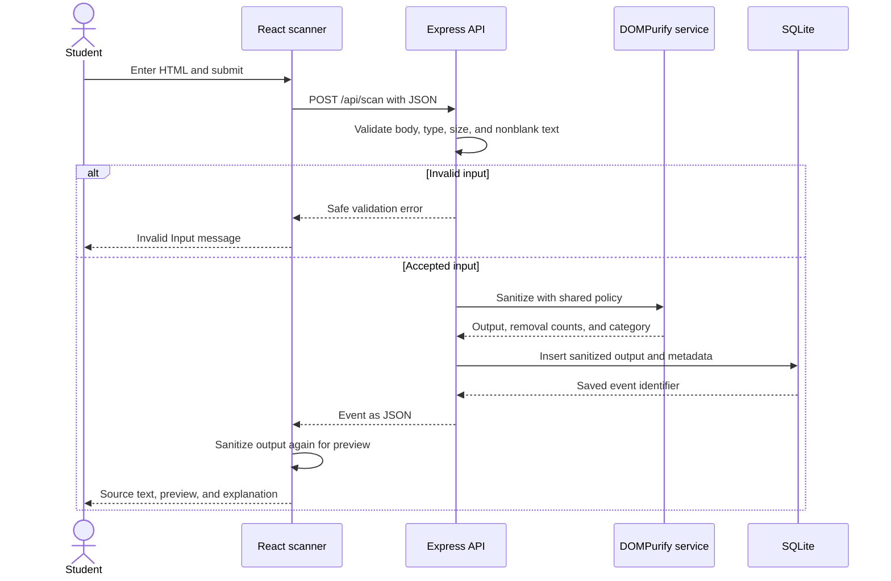
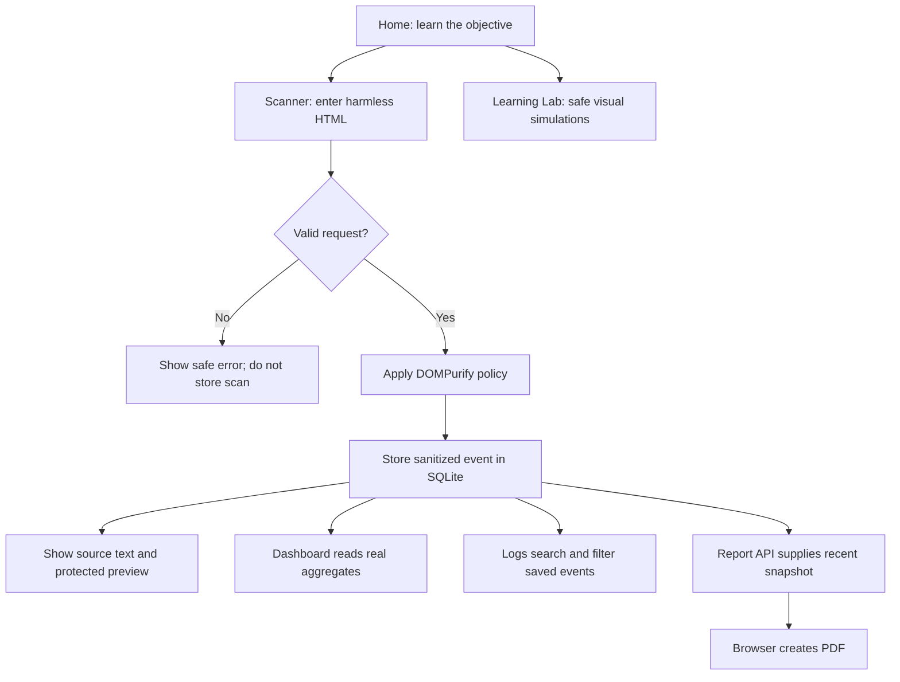

# Understanding XSS Shield

This guide explains the ideas behind the project and how its parts work together. You can read it before opening the code. You do not need to be a security expert to understand the basic workflow.

## 1. What is cybersecurity?

Cybersecurity is the practice of protecting computers, applications, and information from unauthorized access, damage, and misuse. Three common goals are confidentiality (only the right people can read information), integrity (information is not changed without permission), and availability (the service remains usable).

XSS Shield focuses on one small part of application security: handling user-provided HTML safely.

## 2. What is a website security vulnerability?

A vulnerability is a weakness that could allow behavior the developer did not intend. For example, a comment feature might take a visitor's text and insert it directly into a page as HTML. If that text contains active browser instructions, the browser may treat it as part of the website.

Not every malformed input is an attack, and not every removed HTML tag indicates a vulnerability. The important question is whether untrusted content can reach a place where it is interpreted with more authority than it should have.

## 3. What is Cross-Site Scripting?

Cross-Site Scripting, usually shortened to XSS, occurs when untrusted content can cause unwanted script execution in a website's browser context. Browsers trust instructions served by a site. XSS can let an attacker place their own instructions into that trusted context.

This project never runs such instructions. It demonstrates the prevention step and shows the unsafe path only as an educational simulation.

## 4. What are the three major types of XSS?

| Type | How untrusted content travels | Simple example of the data flow |
| --- | --- | --- |
| Stored XSS | Content is saved and later displayed to a visitor | Comment → database → another visitor's page |
| Reflected XSS | A request value is copied into the immediate response | Search term → server response → browser |
| DOM-based XSS | Browser code places untrusted data into an unsafe document operation | URL fragment → browser JavaScript → page |

These describe common sources and paths. Real applications can combine characteristics. A server-side check alone cannot protect unrelated browser code that later inserts unsafe content.

## 5. Why is XSS dangerous?

Unwanted code running in a trusted page can change visible content, mislead users, read information available to that page, or perform actions with the user's permissions. Browser controls such as HttpOnly cookies reduce some consequences but do not solve every XSS risk.

The project avoids collecting secrets and uses harmless examples. Its reported categories describe the sanitization decision, not a prediction of an attack's intent or severity.

## 6. What is a Web Application Firewall?

A WAF inspects web traffic and can apply rules to block suspicious requests before they reach an application. It is one layer in a larger security system. It cannot replace correct application code and context-aware handling of data.

XSS Shield is not a WAF. It is a local application that sanitizes the HTML submitted to its own scanner. It does not monitor network traffic or protect arbitrary websites.

## 7. Validation, sanitization, and output encoding

These three concepts solve different problems:

| Operation | Question it answers | Project example |
| --- | --- | --- |
| Input validation | Is this request acceptable? | Reject a missing `html` value, a number, a blank string, or an oversized string |
| HTML sanitization | Which HTML structures may remain? | Remove a `title` attribute while keeping a permitted paragraph |
| Output encoding | Should this text display literally? | Show `<p>Hello</p>` as characters in a source panel |

A safe demonstration input is:

```html
<p title="classroom">Hello <strong>class</strong></p>
```

The policy permits the paragraph and bold formatting but no attributes, so the expected sanitized form is:

```html
<p>Hello <strong>class</strong></p>
```

In the code panel this is text. In the preview it is permitted HTML, sanitized again in the browser. These two displays deliberately use different rendering contexts.

HTML sanitization is not a general-purpose filter for SQL, shell commands, JavaScript code, or CSS. Each context requires its own safe handling. The server uses SQL parameters for database queries rather than assuming sanitized HTML makes SQL safe.

## 8. How does DOMPurify work?

DOMPurify uses a DOM, the browser's tree representation of a document, to inspect and clean HTML. Its rules determine which elements and attributes are allowed. The application supplies a deliberately small allowlist of basic text formatting tags and no user-provided attributes.

On the server, jsdom supplies the DOM implementation. In the browser, DOMPurify uses the browser's own DOM. The project shares the policy between both sides so they use the same permitted structures.

The application does not try to recognize HTML using regular expressions. HTML parsing has many edge cases, so a maintained sanitizer is more suitable. DOMPurify's removal information is used only to explain what happened; it is not the mechanism deciding whether output may execute.

The [DOMPurify documentation](https://github.com/cure53/DOMPurify#running-dompurify-on-the-server) recommends keeping its server-side DOM dependency current. The project pins resolved versions through `package-lock.json` and checks dependencies during verification.

## 9. What is React?

React is a JavaScript library for building user interfaces from components. A component is a reusable piece of a screen, such as a navigation item, status badge, or scan result panel. State is information React remembers between renders, such as the textarea value or current filter.

When state changes, React updates the displayed interface. Ordinary text expressions are escaped rather than interpreted as HTML. The preview is a special case: it deliberately renders a sanitized HTML fragment. That exception is kept narrow and protected by browser-side DOMPurify.

## 10. What is Node.js?

Node.js runs JavaScript outside a web browser. In this project it runs the local web server, executes sanitization logic, and accesses SQLite. The project uses Node 24 because current dependencies and the built-in SQLite module need a suitable modern runtime.

The installed project-local runtime is selected by the npm scripts. This helps keep the project usable on the original Windows machine without changing its system-wide Node installation.

## 11. What is Express?

Express is a small framework for writing HTTP servers in Node.js. A route connects an HTTP method and path to a handler. For example, `POST /api/scan` handles scan requests, while `GET /api/events` reads saved events.

Middleware runs as a request travels through the server. The project uses middleware for security headers, request limits, input checks, and consistent error responses. In production, Express also serves the files built by Vite.

## 12. What is SQLite?

SQLite is a relational database stored in a local file. A table is like a structured spreadsheet. Each row in `security_events` represents one accepted scan, and each column stores a particular value.

Node's built-in SQLite API opens the file, creates the table and indexes, and runs prepared statements. A parameterized statement keeps a supplied value separate from SQL instructions. This is why a quote in a search term does not become part of the database command.

The file remains on disk when the application stops. Closing and reopening the server therefore preserves events. Automated tests use separate temporary or in-memory databases so they do not modify the demonstration history.

## 13. What is jsPDF?

jsPDF is a JavaScript library that creates PDF documents. The Reports screen requests actual application data, writes headings and text onto PDF pages, wraps long lines, adds pages when needed, and downloads the finished file.

The report contains lifetime totals and a bounded list of recent events. It is a snapshot taken when the data was fetched. It is not a live dashboard or a full export of every stored record.

## 14. How do frontend and backend communicate?

The frontend is the code running in the browser. The backend is the code running in Node.js. They exchange JSON, a text format for structured data, over HTTP.

For a scan, the browser sends a `POST` request with a body like:

```json
{ "html": "<strong>Hello</strong>" }
```

The backend responds with a JSON object containing a `data` property. A failed request instead has an `error` object with a code and safe message. HTTP status codes distinguish success, invalid input, missing records, rate limiting, and server errors.

During production use, frontend and backend share `http://localhost:3000`. During development, Vite serves the frontend and proxies API calls to Express.

## 15. How does the security engine process a request?



The main decisions are:

- **Unchanged:** the output string matches the submitted string and no tracked policy removals occurred.
- **Sanitized:** items outside the policy were removed. This may include harmless formatting that the project simply does not allow.
- **Normalized:** parsing changed the HTML representation without tracked policy removals. For example, a browser can repair an unclosed permitted tag or use lowercase tag names.
- **Invalid Input:** the request does not satisfy validation. It is not stored as an accepted scan.

Removal counts describe operations reported by DOMPurify. They should not be presented as the number of confirmed attacks. A discarded parent element may also discard children, so telemetry is not necessarily a complete inventory of every original node.

## 16. How are security logs stored?

A saved event includes a timestamp, result category, sanitized content, removal counts, input/output lengths, action, and explanation. It does not store the original HTML string. Timestamp and status indexes make common lookups more efficient.

The activity page requests a page of records rather than loading everything at once. Search, status, and date filters are applied in the backend. Dates use UTC boundaries, while browser displays may show local time. The detail view reads one event using its identifier.

Sanitized text can still contain a person's name or other private information. Sanitization is not anonymization. Use nonsensitive demonstration inputs, and treat the database file as local project data.

## 17. How is the PDF generated?

The Reports screen fetches `/api/report`. The response includes the generation timestamp, summary totals, recent events, security recommendations, and limitations. The browser passes these values to the PDF utility.

The PDF utility controls fonts, margins, line wrapping, and page breaks. Page numbers help readers follow a report that spans several pages. Each event's content excerpt is limited to 500 characters so a single large scan cannot make an impractical report. The built-in font uses ASCII text; non-ASCII characters appear as `?` in the PDF. Full saved Unicode content remains available in event details.

The downloaded PDF is generated locally in the browser; the project does not upload its report to a document service.

## 18. How the source is organized

| File or folder | Responsibility |
| --- | --- |
| `package.json` | Dependencies and the supported npm commands |
| `package-lock.json` | Exact resolved dependency tree |
| `client/index.html` | HTML entry point loaded by the browser |
| `client/vite.config.js` | Frontend build output and development API proxy |
| `client/src/main.jsx` | Creates the React application root |
| `client/src/App.jsx` | Application shell and page selection |
| `client/src/components/` | Shared interface elements and safe display components |
| `client/src/pages/` | Home, scanner, lab, dashboard, logs, reports, and about screens |
| `client/src/services/` | Sends API requests and handles JSON responses |
| `client/src/styles/` | Colors, spacing, typography, responsiveness, and focus states |
| `client/src/utils/` | Browser utilities, including report generation |
| `shared/sanitizer-policy.js` | Allowlist shared by server and browser |
| `server/app.js` | Builds the Express app and connects middleware and routes |
| `server/index.js` | Starts the local server and handles shutdown |
| `server/services/` | Validates and sanitizes HTML, classifies results |
| `server/database/` | Creates SQLite tables and runs event queries |
| `server/middleware/` | Reusable request protection and safe error handling |
| `scripts/` | Runs development services from one root command |
| `tests/unit/` | Tests individual functions and security decisions |
| `tests/integration/` | Tests API requests and database behavior |
| `tests/e2e/` | Tests the application through a real browser |

Read `shared/sanitizer-policy.js`, then the sanitization service, then `server/app.js`, and finally the scanner page. That order follows the main security boundary before exploring the UI.

The main backend files are `server/services/sanitizer.js`, `server/database/repository.js`, `server/middleware/validation.js`, and `server/middleware/errors.js`. The browser's API helper is `client/src/services/api.js`, its shared visual components are in `client/src/components/UI.jsx`, and its PDF utility is `client/src/utils/report.js`. Pages have descriptive names such as `Scanner.jsx`, `LearningLab.jsx`, and `Logs.jsx`.

The default persistent database is `data/xss-shield.sqlite`. Optional `.env` settings control the local port and database path; the supplied npm start command reads that file. Keep database paths in the authorized project workspace. The backend accepts at most 120 API requests per minute by default, a scan string of at most 20,000 JavaScript characters, and a JSON body of at most 128 KB.

## 19. Complete application workflow



The scanner performs the real prevention demonstration. The lab explains the surrounding concepts. The dashboard answers “what has been processed?”, the logs answer “what happened to this input?”, and the PDF preserves a readable snapshot.

The project uses several additional controls. Helmet sends browser security headers. Content Security Policy limits where resources and scripts may come from. Request limits help avoid excessive work. Parameterized SQL keeps values separate from commands. The server listens only on the local machine.

## 20. Testing, limitations, and future improvements

Unit tests check individual decisions. Integration tests check that routes, middleware, services, and database work together. End-to-end tests use a browser to check the complete workflow. Coverage measures which source lines or branches executed during tests; it does not establish that every possible behavior is correct.

See [TEST_REPORT.md](TEST_REPORT.md) for measured results. The project aims to cover at least 80% of critical backend logic, and the report records the actual measured coverage rather than an assumed figure.

This application does not protect other websites, identify every possible malicious intention, or provide enterprise monitoring. Its policy intentionally removes many useful HTML features. It has no accounts, authentication, encrypted database, or automatic retention management. It is designed for a small local workload, and a wider deployment would require further design and review.

Useful extensions include a carefully reviewed safe-link policy, authenticated users, controlled retention, additional browser tests, and performance measurements. Any added rendering context must be reviewed separately; sanitized HTML is not automatically safe as JavaScript, a URL, CSS, or SQL.

For the exhibition, demonstrate the real behavior, explain the limits honestly, and be ready to follow one scan through the code. The strongest learning outcome is understanding why the system separates validation, sanitization, safe display, and storage.
