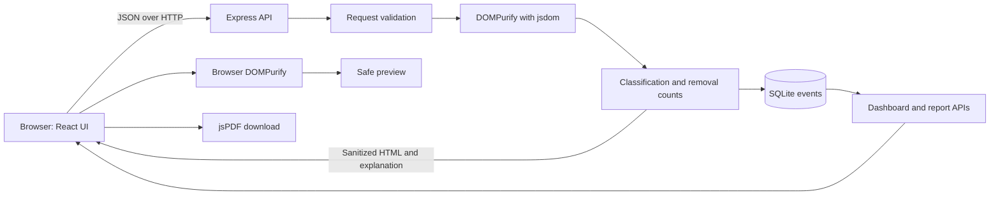
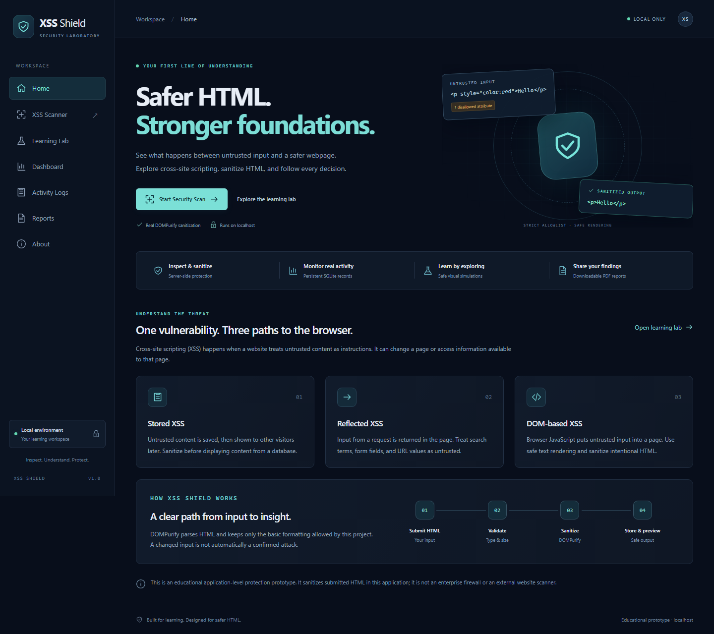
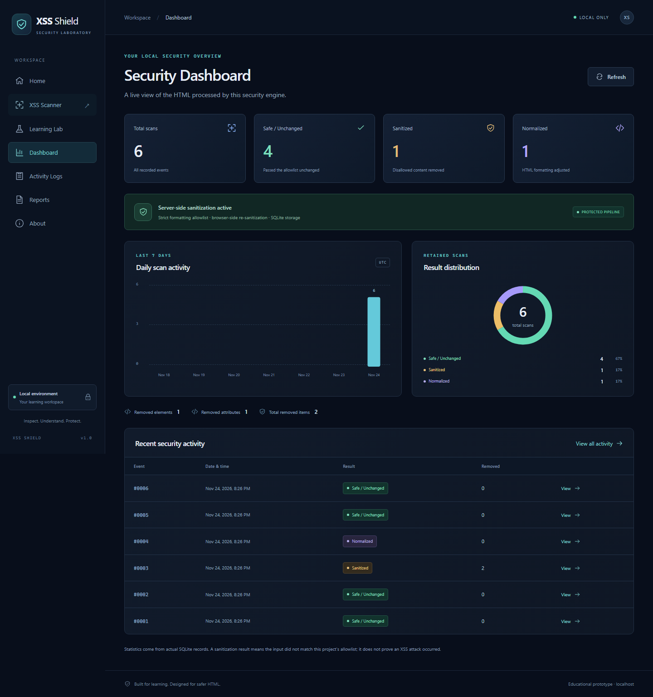

# XSS Shield

**Free online demonstration:** this project includes an opt-in Render Free configuration. See [the deployment guide](docs/FREE_DEMO_DEPLOYMENT.md). Hosted history is shared and temporary; the original local mode remains the default. The source repository is [amarsiddamshetty-maker/xss-shield](https://github.com/amarsiddamshetty-maker/xss-shield). A public Render application URL has not yet been deployed and verified.

XSS Shield is a local educational website that demonstrates how to accept a small HTML fragment, remove content outside a restrictive policy, display the result safely, and keep a useful security history. It is designed for a first-year engineering project and a live college demonstration.

The scanner performs real sanitization with DOMPurify on the server. The Learning Lab uses visual simulations to explain unsafe behavior without executing it. This project is an application-level protection prototype, not an enterprise Web Application Firewall (WAF) or a scanner for other websites.

## Problem and objectives

A website can become vulnerable to Cross-Site Scripting (XSS) when it treats untrusted text as executable browser content. XSS Shield demonstrates a safer workflow: validate the request, sanitize permitted HTML, render it in an appropriate context, and record the decision.

The objectives are to make these decisions visible, explain the three common types of XSS, demonstrate persistent monitoring with SQLite, and produce a report from actual application records. A removed formatting element is a policy violation; it is not automatically evidence of an attack.

## Features

| Screen | What it does |
| --- | --- |
| Home | Introduces XSS, DOMPurify, the project objective, and the processing workflow |
| XSS Scanner | Accepts HTML, offers harmless examples, shows source as text, explains removals, and renders a sanitized preview |
| Learning Lab | Interactively compares protected and unprotected flows using safe visual simulations |
| Dashboard | Shows real scan totals, result distribution, daily activity, removals, and recent events |
| Activity Logs | Searches, filters, and paginates saved events, with a detail view |
| Reports | Downloads a PDF with lifetime totals, recent events, recommendations, limitations, and page numbers |
| About | Explains scope, technologies, and the difference between validation, sanitization, and output encoding |

## Quick start

Open a terminal in this project folder. On this machine the folder is `C:\workspace\college`.

```powershell
cd C:\workspace\college
npm install
npm run build
npm start
```

Open [http://localhost:3000](http://localhost:3000). If your browser resolves localhost differently, use [http://127.0.0.1:3000](http://127.0.0.1:3000). Stop the foreground server with **Ctrl+C**.

In default local mode, the production server binds to `127.0.0.1` only and serves both the compiled React application and the API through one port. Public demonstration hosting is a separate opt-in mode described in the deployment guide.

See [TEST_REPORT.md](TEST_REPORT.md) for actual verification results, [IMPLEMENTATION_STATUS.md](IMPLEMENTATION_STATUS.md) for phase status, and [FINAL_REVIEW.md](FINAL_REVIEW.md) for review findings. Those documents distinguish completed checks from any limits on verification.

## Prerequisites and installation

You need Node.js and npm, an internet connection for the first dependency installation, and a modern browser. A Node.js 24 LTS installation is recommended. The project also installs a local Node 24 runtime as a development dependency, allowing the supplied npm scripts to use a compatible runtime when the host Node is older. The original development machine had Node 20.19.0 available for bootstrapping npm.

Use a full `npm install` or `npm ci`; do not omit development dependencies for this local prototype because they include the build tools and project runtime. `package-lock.json` records the resolved package versions. Use `npm ci` for a clean, reproducible installation from that lockfile.

SQLite is accessed through Node's built-in `node:sqlite` module. There is no separate database server to install or start. Database tables and indexes are created automatically.

## Technology stack

| Technology | Purpose |
| --- | --- |
| HTML5 | Page structure and semantic form elements |
| CSS3 | Responsive layouts, colors, accessible states, and simple charts |
| JavaScript | Browser interactions and server application logic |
| React | Reusable UI components and state updates |
| Vite | Local frontend development and optimized production build |
| Node.js 24 | Runs JavaScript on the server and provides SQLite access |
| Express 5 | Routes HTTP requests to the appropriate service |
| SQLite | Stores security events in a local database file |
| DOMPurify | Removes HTML outside the shared allowlist |
| jsdom | Provides a DOM implementation for server-side DOMPurify |
| jsPDF | Creates downloadable reports in the browser |
| Helmet | Adds browser security headers, including Content Security Policy |
| express-rate-limit | Limits repeated API requests |
| Vitest and Supertest | Test business logic and API behavior |
| Playwright | Tests browser workflows on localhost |
| ESLint | Checks source code for common mistakes |

## Architecture and workflow



1. The student enters text or HTML and submits a scan.
2. Express checks the JSON body, type, empty input, and length limit.
3. DOMPurify parses the fragment and applies the basic formatting allowlist.
4. The service reports an unchanged, sanitized, or normalized result.
5. SQLite stores the sanitized output and event metadata. It does not store the raw submitted HTML.
6. React shows the original input as text and re-sanitizes the server result before rendering the preview.
7. Dashboard, logs, and report requests read the saved records.

## Project structure

```text
college/
├── client/                  React frontend and Vite configuration
│   └── src/
│       ├── components/      Shared UI components
│       ├── pages/           Application screens
│       ├── services/        API communication
│       ├── styles/          Responsive visual styling
│       └── utils/           PDF and other browser helpers
├── server/                  Express app, security services, database
├── shared/                  Sanitization policy used by both sides
├── scripts/                 Local development orchestration
├── tests/
│   ├── unit/                Isolated behavior checks
│   ├── integration/         API and persistence checks
│   └── e2e/                 Browser workflow checks
├── data/                    Runtime SQLite files, excluded from Git
├── docs/                    Demo guide, viva questions, screenshots
├── dist/                    Generated production build
├── package.json             Root npm command interface
├── package-lock.json        Dependency lockfile
├── .env.example             Configuration examples
├── README.md
├── PROJECT_EXPLANATION.md
├── TEST_REPORT.md
├── IMPLEMENTATION_STATUS.md
└── FINAL_REVIEW.md
```

## Development, build, and restart

```powershell
npm run dev
```

Development runs the React development server and the Express backend. Open the frontend URL printed in the terminal, normally [http://localhost:5173](http://localhost:5173). Frontend `/api` requests are proxied to the local backend. This development mode is different from the single-port production build.

For the exhibition, use the production build:

```powershell
npm run build
npm start
```

After source changes, stop the server with Ctrl+C, rebuild, and restart. Rebuilding does not erase the SQLite database. If you have not changed source code, restarting only requires `npm start`.

Optional configuration can be placed in `.env`; `npm start` loads it automatically. To begin with the supplied defaults:

```powershell
Copy-Item .env.example .env
```

| Setting | Default | Meaning |
| --- | --- | --- |
| `PORT` | `3000` | Local production/API port |
| `DB_PATH` | `./data/xss-shield.sqlite` | SQLite file path; keep it inside the project workspace |
| `RATE_LIMIT_MAX` | `120` | Maximum API requests per client in a 60-second window |
| `PUBLIC_DEMO` | `false` | Explicitly enables the shared, temporary public demonstration mode |
| `PUBLIC_ORIGIN` | Unset | Exact HTTPS site origin; public mode falls back to Render's `RENDER_EXTERNAL_URL` |

For an occupied local port, set `PORT=3001` in `.env`, run `npm start`, and open `http://localhost:3001`. Local mode binds to loopback. The development proxy also reads `PORT` from `.env` or the process environment automatically; its browser address remains `http://127.0.0.1:5173`. Stop an existing production server before launching development on the same API port.

## API reference

All endpoints are under `/api`. Successful responses use `{"data": ...}`. Errors use `{"error":{"code":"...","message":"..."}}`. Raw request content is not echoed in error messages.

| Method and route | Purpose |
| --- | --- |
| `GET /api/health` | Checks that the local application is healthy |
| `POST /api/scan` | Validates and sanitizes an HTML string, then stores its event |
| `GET /api/events` | Retrieves a filtered, paginated event list |
| `GET /api/events/:id` | Retrieves one saved event |
| `GET /api/summary` | Returns totals, recent activity, and daily counts |
| `GET /api/report` | Returns report generation time, aggregate totals, recent events, and guidance |

Scan example:

```powershell
$body = @{ html = '<p title="example">Hello <strong>class</strong></p>' } | ConvertTo-Json
Invoke-RestMethod -Uri http://127.0.0.1:3000/api/scan -Method Post -ContentType 'application/json' -Body $body
```

The basic formatting remains, while the disallowed `title` attribute is removed. The scan request must be a JSON object containing only a nonempty string named `html`, of at most 20,000 JavaScript string characters (UTF-16 code units). A 128 KB JSON body size limit applies separately. Blank or invalid input receives an error rather than a saved scan event. Successful creation returns HTTP 201. Invalid requests return 400, oversized requests return 413, and unsupported content types return 415. Unknown events return 404; exceeding the API request limit returns 429.

An event contains `id`, `created_at`, `status`, `sanitized_content`, `removed_count`, `removed_elements`, `removed_attributes`, `original_length`, `sanitized_length`, `action`, and `explanation`.

| Stored status | Meaning |
| --- | --- |
| `unchanged` | The output matched the input under this policy |
| `sanitized` | DOMPurify removed items outside the policy |
| `normalized` | HTML parsing changed the representation without tracked policy removals |

Invalid input is shown as a validation error and is not included in accepted scan totals. A normalized fragment is not a confirmed attack, and an unchanged fragment is not a guarantee that the same text is safe in every possible output context.

Event list query parameters:

| Parameter | Meaning | Example |
| --- | --- | --- |
| `search` | Literal search in sanitized content, explanation, or event ID; maximum 200 characters | `hello` |
| `status` | Filters a stored result category | `sanitized` |
| `from` | Inclusive first calendar date in UTC | `2026-11-01` |
| `to` | Inclusive last calendar date in UTC | `2026-11-24` |
| `page` | Page number from 1 to 1,000,000; default 1 | `2` |
| `pageSize` | Records per page from 1 to 100; default 10 | `10` |

The event list returns `{items,total,page,pageSize,totalPages}` inside `data`. Invalid filters are rejected; SQL parameters are bound separately from query text. Timestamps are stored as ISO UTC strings. Calendar date filters and daily trend buckets use UTC; displayed event times may use the browser's local timezone.

The summary includes lifetime `total`, `unchanged`, `sanitized`, `normalized`, `removed_elements`, `removed_attributes`, and `removed_count`, plus `daily` and `recent` arrays. Daily trends cover seven UTC calendar dates and recent dashboard activity contains the latest six events. The report includes lifetime totals and at most the latest 100 events. Its event section is a bounded recent activity extract, not a full database export.

## Database schema and retention

The application creates `data/xss-shield.sqlite` and its `security_events` table automatically. Its columns are:

| Column | Meaning |
| --- | --- |
| `id` | Integer primary key |
| `created_at` | ISO UTC creation time |
| `status` | Unchanged, sanitized, or normalized result |
| `sanitized_content` | Output after applying the HTML policy |
| `removed_count` | Total tracked removals |
| `removed_elements` | Removed element count |
| `removed_attributes` | Removed attribute count |
| `original_length` | Length of the submitted string |
| `sanitized_length` | Length of the saved output |
| `action` | Human-readable security action |
| `explanation` | Beginner-friendly reason for the result |

Timestamp and status indexes support common filters. Inserts and user-dependent queries use parameters. The database remains available across server restarts. Test databases are separate from the normal application database.

Raw input, cookies, passwords, and IP addresses are not intentionally stored as event fields. However, sanitization does not remove private information from ordinary text. Use only the provided harmless samples or other nonsensitive demonstration content. Logs have no automatic retention cleanup in this prototype.

## Testing

Run commands from the project root:

```powershell
npx playwright install chromium
npm run lint
npm test
npm run test:coverage
npm run build
npm run test:e2e
npm audit
```

The first command installs the browser used by the local end-to-end tests. It only needs to run again after a Playwright browser-version update. Build before running browser tests so they exercise the current production assets.

Unit tests exercise valid and invalid input, policy removal, result categories, and security regression cases. Integration tests cover APIs, event filters, summary accuracy, errors, and persistence. Browser tests exercise navigation, scans, safe rendering, monitoring, filters, responsive layouts, and PDF download against a local server. Coverage reports are generated under `coverage/`.

Read [TEST_REPORT.md](TEST_REPORT.md) for observed counts, measured coverage, fixes, and any tests that could not run. Passing tests and a clean dependency audit describe the checks performed; they are not a proof that all possible vulnerabilities are absent.

## Screenshots

Browser verification captures main-page screenshots under [docs/screenshots](docs/screenshots). See the test report for the actual screenshot inventory and viewport details.





The verified local run also produced a [sample PDF security report](docs/sample-security-report.pdf) using two harmless demonstration records.

## Security design

Validation decides whether the request has an acceptable shape and size. Sanitization removes disallowed HTML structures. Output encoding makes text display literally instead of being interpreted as markup. These are different operations, and the application uses all three where appropriate.

The server is the primary sanitization boundary. The browser repeats sanitization for the preview. Only basic formatting tags are permitted, with no user-provided attributes. Original input and saved log source are rendered as ordinary React text. The Learning Lab never executes an unsafe example.

Helmet provides Content Security Policy and related security headers. Request body limits, rate limiting, loopback binding, parameterized SQL, and safe error responses provide additional safeguards. These controls complement sanitization; they do not replace it. Exact resolved dependency versions are in the lockfile. Keep DOMPurify and jsdom current and rerun the tests after upgrades.

The DOMPurify maintainers explain why the server-side DOM version matters in their [official documentation](https://github.com/cure53/DOMPurify#running-dompurify-on-the-server). See also the [jsdom documentation](https://github.com/jsdom/jsdom), [Node SQLite API](https://nodejs.org/api/sqlite.html), and [jsPDF project](https://github.com/parallax/jsPDF).

## Troubleshooting

| Symptom | What to do |
| --- | --- |
| `npm` is not recognized | Install Node.js with npm, then reopen the terminal |
| An unsupported Node or `node:sqlite` error appears | Run `npm install`, then use the supplied npm commands so the local runtime is selected |
| npm cannot download packages | Check network/proxy settings and approved registry access; keep TLS certificate checks enabled |
| The page is missing after `npm start` | Run `npm run build` first and check the server output |
| Port 3000 is occupied | Stop the previous project process or configure another local port; use the printed URL |
| Scanner reports a connection error | Check the backend is running; development requires both frontend and API |
| The API returns 429 | Too many requests were made; wait for the rate-limit window to reset |
| An input is rejected | Use a nonblank string within the 20,000-character limit |
| Logs appear on a different calendar date | Stored times and date filters use UTC; the browser may display local time |
| Playwright cannot find a browser | Run `npx playwright install chromium` and retry |
| A PDF download is blocked | Check the browser's download settings and retry the download button |
| Changes do not appear in production | Rebuild with `npm run build`, restart, and refresh the browser |

## Scope, limitations, and possible extensions

This prototype protects only the submitted HTML fragment within its own supported rendering context. It does not scan URLs, inspect other applications, provide malware detection, or demonstrate real exploitation. It deliberately excludes links, media, styles, and interactive HTML from user content. Removal counts describe DOMPurify's observed operations and are not an attack severity score or a complete count of every node inside a discarded subtree.

The `removed_elements` telemetry field includes removed DOM nodes such as comments, in addition to HTML elements. Synthetic parser wrappers are excluded. Treat this as an explanation of the sanitizer's reported operations, not an exact census of the original document.

The application is intended for one local demonstration user. It has no authentication, user accounts, encryption at rest, multi-user authorization, or automatic log retention. SQLite access and sanitization are synchronous, suitable for this modest workload. Browser verification covers the browser configurations listed in the test report, not every device. PDF event excerpts are limited to 500 characters and non-ASCII characters appear as `?` because the report uses a built-in PDF font. The database and log view preserve the full saved Unicode text.

Future work could add authenticated access, retention settings, richer accessibility testing, additional browser coverage, a reviewed policy for safe links, or broader performance measurements. Any wider deployment would require a separate security design and review.

## Learning and presentation materials

- [PROJECT_EXPLANATION.md](PROJECT_EXPLANATION.md): concepts, source-code map, and request walkthrough.
- [docs/DEMO_GUIDE.md](docs/DEMO_GUIDE.md): introduction and five-minute exhibition demonstration.
- [docs/VIVA_QUESTIONS.md](docs/VIVA_QUESTIONS.md): questions and simple answers for preparation.
- [requirement.md](requirement.md): original requested scope.
